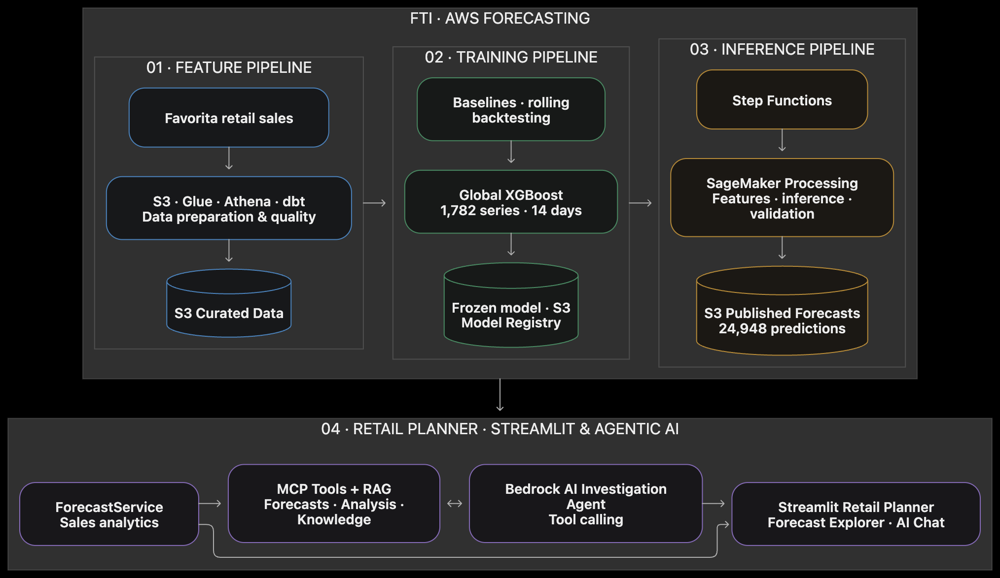
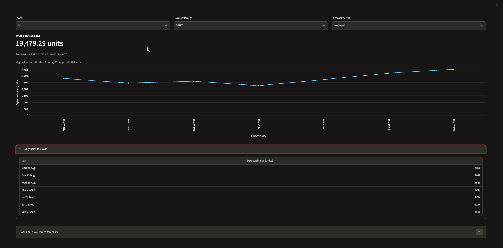
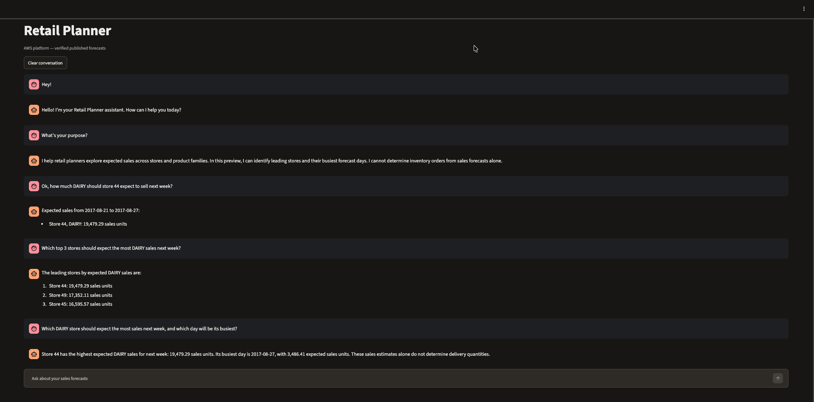

# Production-Grade Retail Demand Forecasting & AI Planning Platform on AWS

**An end-to-end retail demand forecasting and AI-powered decision-support platform, combining Machine Learning, AWS MLOps, and an agentic AI application for business users.**

This portfolio project simulates a Data Science consulting engagement for a large retail organization: from framing a demand-planning problem and developing forecasting models to operationalizing predictions on AWS and making them accessible through an interactive Retail Planner.

Rather than stopping at model accuracy, the project addresses the full journey from **data to operational decisions**.

## Key Results

| Dimension | Outcome |
| --- | --- |
| Business scope | 54 stores, 33 product families, 1,782 daily sales series |
| Forecasting horizon | 14 days per store–family combination |
| Forecasting model | Global direct multi-horizon XGBoost |
| Final holdout WAPE | **18.77%**, versus **23.21%** for seasonal naive |
| Relative error reduction | **19.12%** against the baseline |
| AWS batch inference | 24,948 forecasts generated, validated, and published to S3 |
| Business application | Streamlit Forecast Explorer and Bedrock-powered AI Investigation Agent |
| Validation | 287 tests and 21 subtests passed locally |

The forecasting evaluation uses an untouched temporal holdout. The performance figures are measured against the same evaluation window and do not represent an uplift in revenue or realized inventory savings.

## Business Challenge

Retail planning teams need reliable short-term demand estimates to anticipate sales fluctuations and support inventory and replenishment decisions.

This project uses the [Corporación Favorita Store Sales dataset](https://www.kaggle.com/competitions/store-sales-time-series-forecasting) to simulate that challenge.

The platform produces 14-day sales forecasts at the **store × product family × day** level, with the aim of helping planners:

- anticipate demand peaks and slowdowns;
- investigate expected sales across stores and product families;
- understand the assumptions and limitations behind the forecasts;
- access planning information without needing to operate ML pipelines directly.

Because the source dataset contains sales but no reliable inventory or stock-out observations, the platform forecasts **observed sales**, not unconstrained demand or optimal replenishment quantities.

## System Architecture

The platform follows a **Feature–Training–Inference (FTI)** architecture, with an integrated Retail Planner that translates validated forecasts into accessible business insights.

The core forecasting system separates data preparation, model development, and batch inference. The Retail Planner consumes published AWS forecasts instead of training or serving an additional forecasting model.

### 1. Feature Pipeline

**Amazon S3 · AWS Glue · Amazon Athena · dbt · Python**

Historical retail data is ingested, cataloged, transformed, and quality-checked to produce curated datasets for forecasting.

The data layer includes SQL transformations, business-key uniqueness checks, schema validation, and reproducible feature engineering.

### 2. Training Pipeline

**Python · XGBoost · Time-series backtesting · SageMaker Model Registry**

The modeling process covers seasonal naive baselines, classical time-series diagnostics, global forecasting, hyperparameter selection, and temporal validation.

The selected champion is a global, direct horizon-conditioned XGBoost model trained across 1,782 related sales series.

A frozen model contract ensures consistent feature definitions and reproducible inference.

A separate research track investigates promotion-aware forecasting and causal uplift. The promotion extension was not retained in the operational champion because it did not demonstrate a robust forecasting improvement.

### 3. Inference Pipeline

**AWS Step Functions · SageMaker Processing · Amazon S3 · Amazon ECR**

AWS Step Functions orchestrates batch feature preparation, inference, validation, and forecast publication.

SageMaker Processing executes containerized workloads using the frozen model and its defined feature contract.

Validated forecasts are published as Parquet artifacts in S3, providing a stable interface for downstream applications.

This batch architecture matches the business requirement for periodic demand planning without maintaining an unnecessary real-time model endpoint.

### 4. Retail Planner & AI Investigation Agent

**Streamlit · Amazon Bedrock · Model Context Protocol (MCP) · RAG**

The Retail Planner is an integrated component of the forecasting platform, providing two complementary capabilities within a single Streamlit application.

#### Forecast Explorer

Planners can select a store, product family, and forecast period to explore expected sales, daily patterns, and demand peaks.

#### AI Investigation Agent

A Bedrock-powered agent uses MCP tools to retrieve and analyze published sales forecasts, consult curated business knowledge, and check planning-data availability.

This enables conversational investigations, including comparisons across stores, identification of peak-demand days, and follow-up questions that depend on earlier results.

Forecast quantities come from deterministic application services rather than being invented by the language model. Business evidence is validated before a response is accepted.

## AWS MLOps & Engineering

The platform includes production-oriented engineering practices across the ML lifecycle:

| Area | Implementation |
| --- | --- |
| Data quality | dbt tests, schema checks, point-in-time feature controls |
| Model evaluation | Rolling-origin backtesting, holdout evaluation, WAPE, MAE, RMSE, bias |
| Reproducibility | Frozen model contracts, containerized execution, parity checks |
| Model governance | SageMaker Model Registry, champion/challenger lifecycle |
| Orchestration | Step Functions workflows for batch forecasting and CT readiness |
| Monitoring | CloudWatch dashboards and alarms, SNS notifications |
| Continuous training readiness | Checkpoints, new-data eligibility controls, DynamoDB concurrency lock |
| CI/CD | GitHub Actions, automated tests, Docker, ECR, controlled infrastructure deployment |
| Application deployment | Temporary ECS/Fargate deployment behind an HTTPS Application Load Balancer |
| Agent reliability | MCP tool contracts, deterministic evidence validation, failure-path tests |

The historical dataset ends in 2017. Consequently, daily scheduling and automatic model promotion are intentionally not enabled: recurring retraining without new labeled data would not represent a meaningful operational workflow.

The platform instead demonstrates guarded retraining components, model governance, and readiness checks designed for future data updates.

## AWS Demonstration

The integrated application was successfully demonstrated on AWS in November 2026.

The demonstration connected a containerized Streamlit application to forecasts produced by a successful Step Functions execution and published to S3.

Both the Forecast Explorer and the AI Investigation Agent operated on the same historical forecasting snapshot.

The application was deployed temporarily using Amazon ECS/Fargate and an HTTPS load balancer with restricted network access. Active demonstration compute and load-balancing resources were subsequently stopped and removed.

**The application is not hosted as a continuously available public service.** The screenshots above document the working AWS demonstration.

## Project Structure

| Location | Purpose |
| --- | --- |
| `notebooks/` | Data exploration, forecasting research, causal analysis, GenAI experiments |
| `src/features/` | Point-in-time feature engineering |
| `src/forecasting/` | Forecasting logic and model contracts |
| `src/agent/` | MCP tools, forecasting services, agent orchestration and validation |
| `src/knowledge/` | Curated knowledge retrieval |
| `src/planner_app/` | Retail Planner application services and AWS integration |
| `app/` | Streamlit user interface |
| `dbt/` | SQL transformations and data quality tests |
| `pipelines/` | AWS batch and continuous-training workloads |
| `infrastructure/` | Cloud infrastructure, IAM policies and orchestration definitions |
| `tests/` | Automated unit, integration and reliability tests |
| `docs/` | Business knowledge, technical documentation and portfolio assets |

## Design Principles

- **Start with the business decision.** The goal is usable demand-planning information, not model complexity for its own sake.
- **Separate training from inference.** Batch predictions can be generated without retraining the champion model.
- **Prevent temporal leakage.** Features and evaluation protocols respect what was known at each forecast origin.
- **Prefer measured improvements.** The champion is selected using temporal evidence rather than adding unproven complexity.
- **Make forecasts traceable.** Published predictions are tied to model artifacts, validation contracts, and workflow executions.
- **Keep AI grounded in business data.** The investigation agent uses deterministic forecasting tools and curated knowledge.
- **Design for adoption.** A single Retail Planner interface makes forecast exploration and natural-language investigation accessible to business users.

## Scope and Reproducibility

This is a **portfolio project simulating a client delivery**, not a claim of deployment inside a real retailer.

The dataset is historical, the AWS demonstration was temporary, and the implemented retraining controls are intentionally guarded rather than configured for autonomous daily model promotion.

The repository provides the modeling notebooks, application code, automated tests, infrastructure definitions, and selected execution evidence. Reproducing cloud workflows requires an independently configured AWS environment and appropriate permissions.
